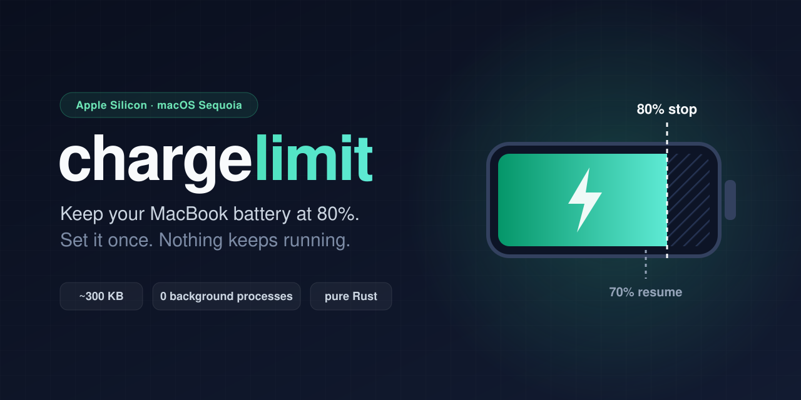

<p align="center">
  
</p>

I just wanted my battery limiter app to have no background processes, turns out it was possible.

**chargelimit** does exactly that, and then gets out of the way.

## Why another one?

Most charge limiters keep an app or a background process running so they can
switch charging off at the right moment. I wanted something that costs nothing.

It turns out the firmware that ships with **macOS Sequoia 15.8** on Apple Silicon
can enforce a charge limit on its own. You tell it "stop at 80, start again below
70" and it handles the rest, even while the Mac is asleep. chargelimit just writes
those two numbers and exits.

- **No background process.** It runs for a few milliseconds and quits.
- **Tiny.** One ~300 KB binary, written in Rust with zero dependencies.
- **Survives reboots.** A launchd job runs it once at startup to re-apply your setting, then exits.

This is also why tools like Battery Toolkit say *"Your Mac is not supported"* on
15.8: they look for older firmware controls that no longer exist.

## Is it for me?

It's built for and tested on an **M1 MacBook Pro running macOS 15.8.3**. It should
work on other Apple Silicon MacBooks on Sequoia 15.8. If your firmware doesn't have
the right controls, chargelimit says so and refuses to do anything.

On **macOS 26.4 and later** you probably don't need this: Apple added a Charge Limit slider
under *System Settings → Battery*. (That slider stops at 80% though, and chargelimit lets you
go lower.)

## Install

**The easy way:** grab the ready-made package from
[Releases](https://github.com/Shadrous/chargelimit/releases/latest) and install it from Terminal:

```sh
curl -LO https://github.com/Shadrous/chargelimit/releases/download/v0.1.0/chargelimit-0.1.0.pkg
sudo installer -pkg chargelimit-0.1.0.pkg -target /
```

The package isn't signed by Apple, so double-clicking it will be blocked. The
`installer` command above works fine.

**Or build it yourself** with [Rust](https://rustup.rs):

```sh
git clone https://github.com/Shadrous/chargelimit.git
cd chargelimit
sh build.sh
sudo installer -pkg dist/chargelimit-0.1.0.pkg -target /
```

Either way, your Mac now stops charging at 80% and resumes below 70%.

## Use

```sh
chargelimit status            # what's going on right now
sudo chargelimit set 75 65    # stop at 75%, resume below 65%
sudo chargelimit off          # back to normal charging to 100%
```

Your setting is remembered across restarts.

```
$ chargelimit status
battery: 78%, charging (1731 mA), adapter connected
limit:   on (stop at 80%, resume below 70%)
```

**Good to know:** if the battery is already above your limit when you plug in, the
Mac runs on the charger and lets the battery drift down to the limit. That's
expected.

## Uninstall

```sh
curl -LO https://github.com/Shadrous/chargelimit/releases/download/v0.1.0/uninstall.sh
sudo sh uninstall.sh
```

(If you built from source, `sudo sh dist/uninstall.sh` does the same.)

This turns the limit off (normal charging) and removes everything chargelimit installed.

## How it works

Apple Silicon Macs have a System Management Controller (SMC) that handles power.
On Sequoia 15.8 firmware it exposes three keys:

| Key    | Meaning                   |
|--------|---------------------------|
| `bfF0` | limit on (`2`) / off (`0`) |
| `bfD0` | stop charging at this %   |
| `bfE0` | resume charging below this % |

chargelimit talks to the SMC through IOKit, writes these keys and exits. The whole
thing is under 300 lines in [`src/`](src). Credit to
[batt](https://github.com/charlie0129/batt) for documenting these keys.

## Notes

- This is a personal tool with a short shelf life. I just wanted an immediate solution before the
  eventual move to a higher version
- This targets Sequoia's firmware and
  may stop working (or become pointless) after a big macOS update. Uninstall it
  **before** upgrading.
- It writes to your Mac's power controller as root. It only touches the three keys
  above, but you're running it at your own risk.

## License

MIT
